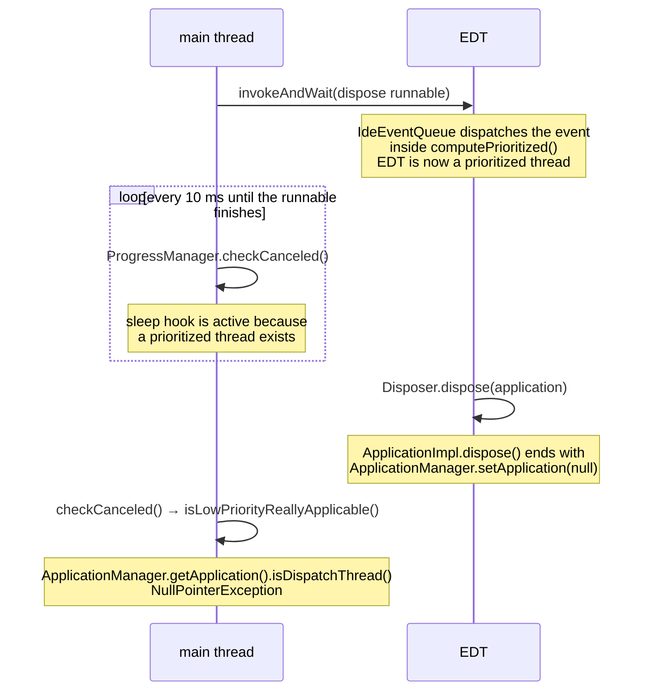

# NullPointerException while a headless MPS 2023.2 worker disposes its `IdeaEnvironment`

**Question this answers:** a headless MPS 2023.2 worker that runs on `IdeaEnvironment` (for example the worker behind
the Ant `migrate` task) sometimes finishes its work and then exits with code 1 because the main thread fails during
environment disposal:

```text
Exception in thread "AWT-EventQueue-0" java.lang.NullPointerException: Cannot invoke
  "com.intellij.openapi.application.ex.ApplicationEx.runIntendedWriteActionOnCurrentThread(java.lang.Runnable)"
  because the return value of "com.intellij.openapi.application.ex.ApplicationManagerEx.getApplicationEx()" is null
    at com.intellij.ide.IdeEventQueue.dispatchEvent(IdeEventQueue.kt:405)
workFromMain
java.lang.NullPointerException: Cannot invoke "com.intellij.openapi.application.Application.isDispatchThread()"
  because the return value of "com.intellij.openapi.application.ApplicationManager.getApplication()" is null
    at com.intellij.openapi.progress.impl.CoreProgressManager.isLowPriorityReallyApplicable(CoreProgressManager.java:863)
    at com.intellij.openapi.progress.impl.CoreProgressManager.sleepIfNeededToGivePriorityToAnotherThread(CoreProgressManager.java:838)
    at com.intellij.openapi.progress.impl.ProgressManagerImpl.runCheckCanceledHooks(ProgressManagerImpl.java:192)
    at com.intellij.openapi.progress.impl.CoreProgressManager.doCheckCanceled(CoreProgressManager.java:145)
    at com.intellij.openapi.progress.ProgressManager.checkCanceled(ProgressManager.java:231)
    at com.intellij.openapi.application.impl.LaterInvocator.invokeAndWait(LaterInvocator.java:119)
    at com.intellij.openapi.application.impl.ApplicationImpl.invokeAndWait(ApplicationImpl.java:471)
    at jetbrains.mps.tool.environment.IdeaEnvironment.doDispose(IdeaEnvironment.java:246)
    at jetbrains.mps.tool.environment.EnvironmentBase.dispose(EnvironmentBase.java:170)
    at jetbrains.mps.tool.builder.WorkerBase.dispose(WorkerBase.java:165)
    at jetbrains.mps.tool.builder.WorkerBase.workFromMain(WorkerBase.java:143)
    at jetbrains.mps.build.migration.MigrationWorker.main(MigrationWorker.java:139)
```

What causes it, does a newer MPS fix it, and can a caller avoid it?

**Answer:** it is a race in IntelliJ Platform 232 between the main thread waiting in `invokeAndWait` and the EDT
disposing the application. MPS 2023.2.3, the last 2023.2 release, has the same dispose code and the same platform, so it
is affected too. Platform 233 removed the dereference that throws, so MPS 2023.3 and later should not hit it. No system
property, registry key, or Ant task attribute avoids it in 2023.2. The failure happens after the worker's work is done,
but the stock Ant tasks still report the build as failed.

Applies to MPS 2023.2.0 to 2023.2.3, which bundle IntelliJ Platform build 232.10335.

## The race

`IdeaEnvironment.doDispose()` runs on the worker's main thread. It calls `Application.invokeAndWait(...)` with a
runnable that closes projects and then calls `Disposer.dispose(application)` inside a write action. The main thread
blocks until that runnable finishes on the EDT.



**Verified** from platform source at tag `idea/232.10335.12`. Every line number in the stack trace above matches that
tag.

1. `platform/platform-impl/src/com/intellij/ide/IdeEventQueue.kt`, lines 346–373: while the application exists and is
   not disposed, every EDT event is dispatched inside `ProgressManager.computePrioritized(...)`. There is no switch
   around this.
2. `platform/core-impl/src/com/intellij/openapi/progress/impl/CoreProgressManager.java`, `computePrioritized` and
   `changePrioritizing`: the first prioritized thread calls `prioritizingStarted()`. In
   `platform/platform-impl/src/com/intellij/openapi/progress/impl/ProgressManagerImpl.java` that sets `myRunSleepHook`
   and makes `checkCanceled()` run hooks on every thread.
3. `platform/core-impl/src/com/intellij/openapi/application/impl/LaterInvocator.java`, line 118: the waiting thread
   loops on `semaphore.waitFor(ConcurrencyUtil.DEFAULT_TIMEOUT_MS)` (10 ms) and calls `ProgressManager.checkCanceled()`
   after each timeout. `ProgressManager.getInstanceOrNull()` returns a cached static, so it stays non-null after the
   application is disposed.
4. `CoreProgressManager.sleepIfNeededToGivePriorityToAnotherThread()` calls `isLowPriorityReallyApplicable()`. After two
   early returns (prioritization younger than 5 ms, or a prioritized thread in `WAITING`, `TIMED_WAITING` or `BLOCKED`
   state), line 863 calls `ApplicationManager.getApplication().isDispatchThread()`.
5. `platform/platform-impl/src/com/intellij/openapi/application/impl/ApplicationImpl.java`, line 383: the non-test
   `ApplicationImpl` constructor leaves `myLastDisposable` null, so `dispose()` ends with
   `ApplicationManager.setApplication(null)`.

The exception propagates out of `invokeAndWait`, through `EnvironmentBase.dispose()` and `WorkerBase.dispose()`, into
the `catch (Throwable)` in `WorkerBase.workFromMain()`, which calls `System.exit(1)`
(`core/tool/builder/source_gen/jetbrains/mps/tool/builder/WorkerBase.java`, lines 132–155). **Verified.**

**Inferred:** the window is short. It opens when `ApplicationImpl.dispose()` clears the application reference and closes
when the EDT runnable releases the semaphore or the EDT stops being prioritized. The main thread must also poll inside
that window while the EDT is runnable. This explains why the failure is intermittent.

**Observed:** once in a CI run of the Ant `migrate` task on MPS 2023.2.2, JetBrains Runtime 17.0.14, Linux x64. The
sibling run without the `force` flag passed in the same build.

The `AWT-EventQueue-0` exception from `IdeEventQueue.kt:405` is a side effect. The next EDT event finds no application.
It is printed but does not change the exit code.

## What the caller cannot change

**Verified** in MPS 2023.2.3 sources:

- **No platform switch.** The prioritized dispatch in `IdeEventQueue` and the sleep hook have no system property or
  registry key. `CoreProgressManager.suppressAllDeprioritizationsDuringLongTestsExecutionIn` would disable the hook, but
  it is `@TestOnly` and only wraps code passed to it.
- **`failOnError="false"` does not help.** `MpsLoadTask` (`core/tool/ant/source_gen/jetbrains/mps/build/ant/`) throws
  `BuildException("Process exited with code ...")` for any non-zero exit of the forked worker, independent of
  `failOnError` (lines 280–287 and 424–426). `failOnError` only controls whether `WorkerBase.failBuild()` turns logged
  errors into exit code -13.
- **The migration result is lost.** `MigrationWorker.work()` writes `migration_result.properties` before disposal
  (`plugins/mps-build/solutions/jetbrains.mps.build.mps.migration/source_gen/jetbrains/mps/build/migration/MigrationWorker.java`,
  lines 124–134). `MigrationTask.execute()` reads it only after `super.execute()` returns normally, and registers it
  with `deleteOnExit()` (`core/tool/ant/source_gen/jetbrains/mps/build/ant/MigrationTask.java`, lines 88–105). So a
  successful migration followed by this crash is reported as a failed build.

**Inferred:** a caller that controls the worker class could subclass the worker and override the protected
`WorkerBase.dispose()` to tolerate this exception. That needs code compiled against MPS jars and a custom launch or Ant
task, so it is not a configuration change. Retrying an in-place operation such as migration is also possible, because an
already migrated project normally has nothing left to migrate.

## Version differences

| MPS                 | Platform  | `doDispose()` | Throwing dereference in `isLowPriorityReallyApplicable()` |
| ------------------- | --------- | ------------- | --------------------------------------------------------- |
| 2023.2.0 – 2023.2.3 | 232.10335 | as above      | present                                                   |
| 2024.1.6            | 241.19416 | unchanged     | replaced by `EDT.isCurrentThreadEdt()`                    |
| 2025.1.4            | 251.x     | unchanged     | replaced by `EDT.isCurrentThreadEdt()`                    |
| 2026.1              | 261.x     | unchanged     | replaced by `EDT.isCurrentThreadEdt()`                    |

- **Verified:** `IdeaEnvironment.doDispose()` has the same body in MPS 2023.2.3, 2024.1.6, 2025.1.4, and 2026.1
  (`workbench/mps-platform/jetbrains.mps.ide.platform/source_gen/jetbrains/mps/tool/environment/IdeaEnvironment.java`).
- **Verified:** between the `2023.2.2` and `2023.2.3` tags of the MPS repository, `IdeaEnvironment` changed only in
  `init()`, and `MigrationWorker`, `WorkerBase` and the Ant tasks did not change.
- **Inferred:** MPS 2023.2.3 bundles the same platform build as 2023.2.2. No dependency or build file changed between
  the tags; only plugin descriptors changed.
- **Verified:** IntelliJ Platform commit `88aae8a567f5` ("more flatter app init", 2023-08-02) replaced
  `ApplicationManager.getApplication().isDispatchThread()` with `EDT.isCurrentThreadEdt()` in
  `isLowPriorityReallyApplicable()`. The first tag containing it is `idea/233.6745.305`. The method has no other
  application access in `idea/241.19416.15`, `idea/251.29188.36` or the current master branch.
- **Inferred:** MPS 2023.3 bundles a 233 platform build newer than `233.6745.305` and is not affected. Its exact build
  was not checked.

## Unresolved

- Whether other code that runs on the main thread after `ApplicationManager.setApplication(null)` can still fail in MPS
  2023.3 and later. Only the path in this stack trace was checked.
- Whether MPS 2023.1 and older, which use earlier platforms, have the same race.
